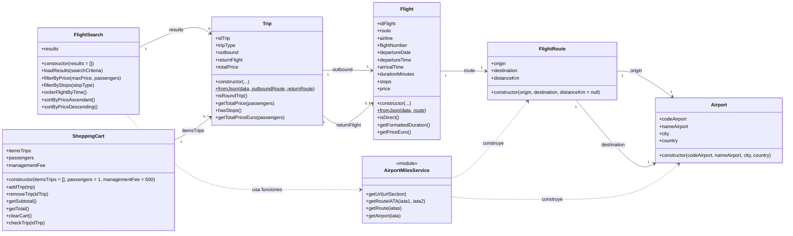

# AirBridge — Diagrama UML de clases (versión final)

Basado en los archivos `Airport.js`, `FlightRoute.js`, `Flight.js`, `Trip.js`, `FlightSearch.js`, `ShoppingCart.js` y `AirportMilesService.js` facilitados para el proyecto.

## Cómo interpretar el diagrama

- `+` representa un miembro público. Los métodos `fromJson()` de `Flight` y `Trip` son estáticos (`$` en Mermaid).
- `Trip` tiene **un vuelo de ida obligatorio** y **un vuelo de vuelta opcional**.
- `FlightRoute` referencia **dos aeropuertos**, cada uno con un papel propio: `origin` y `destination`.
- `FlightSearch` mantiene una colección de viajes (`results`), y `ShoppingCart` otra (`itemsTrips`).
- `AirportMilesService` es un **módulo de funciones asíncronas**, no una clase. Se representa como `<<module>>` para documentar sus dependencias.
- Las flechas representan referencias y usos del código; no indican herencia. Los atributos no llevan tipos estáticos porque el código JavaScript no los declara.
- `travel.json` se usa como fuente de datos, pero no se incluye como clase UML.

### Nota de alcance

Este es un **diagrama de clases y dependencias del modelo**, no un diagrama de navegación de páginas ni un diagrama de base de datos.
